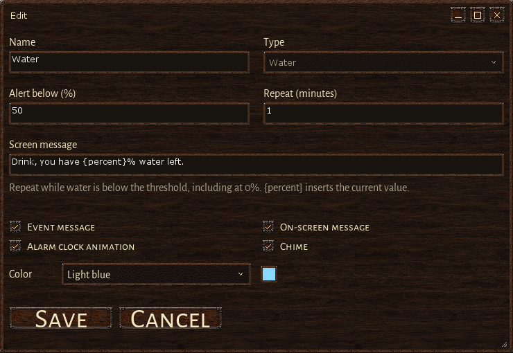
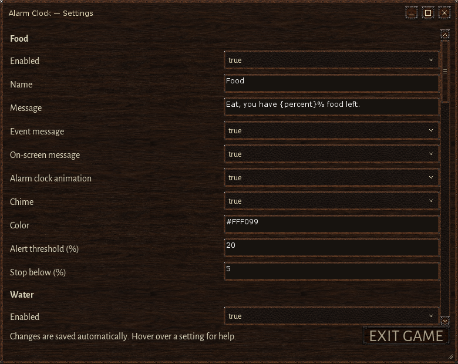

# Alarm Clock

Keep track of food, water, prayer, meditation and full Favor in Wurm Unlimited. Open your reminders from the draggable HUD clock or the Main menu. Alarms keep running while the list is closed.

**[Download 0.3.9](https://github.com/chamomilo/wurm-alarm-clock/releases/download/v0.3.9/alarmclock-0.3.9.zip)** · [All releases](https://github.com/chamomilo/wurm-alarm-clock/releases) · [Report a problem](https://github.com/chamomilo/wurm-alarm-clock/issues)


## Install or update

1. Install the Wurm Unlimited client mod launcher.
2. Close the game and extract the ZIP's `mods` folder into your Wurm Unlimited client folder. Allow replacement of the existing Alarm Clock files when updating.
3. Start the client. Click the HUD clock or select **Alarm Clock** in the Main menu.

Your saved alarms and preferences are retained. The download contains only:

```text
README.txt
mods/alarmclock.properties
mods/alarmclock/alarmclock.jar
```

The shared Chamomilo updater **1.5.0**, common Settings editor and interface kit **0.4.11** are included in the JAR. No separate updater download is needed.

## Built-in reminders

| Alarm | When it reminds you | How it resets or stops |
| --- | --- | --- |
| Food | At 20% remaining, then each lower whole percentage through 5% | Eating rearms it; below 5% it stays silent |
| Water | Immediately below 50%, then every minute, including at 0% | Refill to 50% or higher |
| Prayer | After 20 minutes, then every minute | Successful prayer restarts the countdown when **Restart after praying** is selected |
| Meditation | After 30 minutes, then every minute | Successful meditation restarts the countdown when **Restart after meditation** is selected |
| Favor | When current Favor reaches Faith, then every minute while full | Spending Favor stops reminders; refilling rearms them |

Starting, cancelling or failing prayer or meditation leaves its timer running. **Restart** starts a fresh countdown manually.

Choose **New alarm** to create custom timers or additional Food, Water and Favor monitors. A timer can have repeat `0` for a single reminder; Water and Favor require a positive repeat interval. Built-in alarms can be disabled, and custom alarms can also be deleted.

## Make each reminder your own

Every alarm has four independent switches:

- **Event message** writes to Wurm's Event channel.
- **On-screen message** displays large text above windows and popups, fading over three seconds.
- **Alarm clock animation** rings the HUD clock for three seconds.
- **Chime** plays the alarm's sound. **Test chime** previews it immediately.

Chimes are queued when alarms coincide. Prayer has three clear, spaced notes with a soft fade.

Select a named color from the palette on a card or in **Edit**. Food is gold, Water light blue, Prayer pink, Meditation lavender, Favor mint green and custom timers orange. The color applies to messages, the animated clock and the card tint. The palette shows a swatch; the common Settings editor also accepts custom `#RRGGBB` or `R,G,B` values.


**Disable** immediately stops an alarm, clears its visible reminders and cancels queued chimes. The disabled state is saved across restarts and reconnects. Saving an editor opened before disabling a Food, Water or Favor monitor keeps that monitor disabled.

## Edit an alarm

**Edit** changes the name, message and relevant timing or threshold fields. Water has **Alert below (%)** and **Repeat (minutes)**, with no lower cutoff.



For all parameters in one place, open the shared **Mods Registry** and select **Settings** on the Alarm Clock card. Hover over a field for help. Valid changes are saved and applied immediately; invalid input preserves the saved value.



The shared language selector supports English, Brazilian Portuguese, German and Russian. Names and messages you enter are kept as written. See [Settings details](docs/SETTINGS.md) for colors and migration behavior.

## HUD and saved data

Drag the HUD clock to move it. **HUD Settings** can hide or show it. Console commands:

| Command | Action |
| --- | --- |
| `alarmclock` | Open the alarm list |
| `alarmclockshow` | Show the clock at its default position |

Alarms, preferences and timer deadlines are stored in `.chamomilo/alarmclock.properties` under your Windows user folder. Older Water settings migrate once to 50% and one minute, retaining enabled state and message. The updated default palette replaces old standard colors once and preserves nonstandard custom shades.

Alarms stay silent while disconnected and resume without a burst of missed reminders. Alarm Clock provides reminders; game actions remain under your control.

## In this release

- Rebuilt with the current shared updater 1.5.0 and verified its complete embedded contents.
- Reminders render above windows and popups while allowing mouse input through them.
- Distinct default colors and a compact named palette on cards and editors; custom colors remain available in Settings.
- Updated illustrated guide and a minimal installable ZIP.
