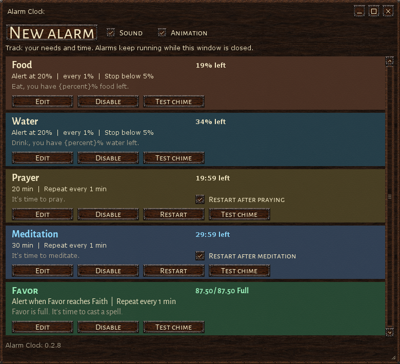
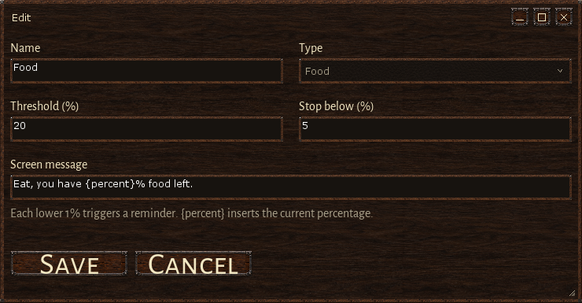

# Alarm Clock

A Wurm Unlimited client mod for food, water, prayer, meditation and Favor reminders. The clock stays on your HUD, while alarms continue running with the list closed.

**[Download the latest release](https://github.com/chamomilo/wurm-alarm-clock/releases/latest)** · [Installation](#installation) · [Controls](#controls)



## Installation

1. Install the Wurm Unlimited client mod launcher.
2. Download `alarmclock-0.2.8.zip` from [Releases](https://github.com/chamomilo/wurm-alarm-clock/releases/latest).
3. Extract its `mods` folder into your Wurm Unlimited client folder and restart the client.

The installable ZIP contains exactly three files:

```text
README.txt
mods/alarmclock.properties
mods/alarmclock/alarmclock.jar
```

Chamomilo updater **1.4.1** and Chamomilo UI **0.4.11** are embedded in the JAR. Existing alarm settings are preserved; no separate updater installation is needed. Source code, screenshots and development files stay in this repository and are excluded from the installable ZIP.

## Default alarms

| Alarm | When it reminds | When it resets or stops |
| --- | --- | --- |
| Food | At 20% remaining, then every lower whole percentage through 5% | Refilling food rearms the monitor; below 5% it stays silent |
| Water | At 20% remaining, then every lower whole percentage through 5% | Refilling water rearms the monitor; below 5% it stays silent |
| Prayer | After 20 minutes, then every minute | Successful prayer restarts the timer when its checkbox is enabled |
| Meditation | After 30 minutes, then every minute | Successful meditation restarts the timer when its checkbox is enabled |
| Favor | Immediately when Favor reaches current Faith, then every minute while full | Spending Favor stops reminders; refilling it starts them again |

Prayer and meditation reset only after your character successfully completes the activity. Starting, cancelling or failing it, another player's activity, and ordinary chat do not reset timers. Manual **Restart** is on each timer's card. Disabled alarms remain disabled.

## Clear reminders

Messages use plain **36 px bold system text**, centered at Wurm's native message position, with the native shadow and three-second fade. Food, Water and Prayer use gold, Meditation uses light blue, and Favor uses mint green. There is no caption plate behind the text.


Each alarm has a colored card and a distinct gentle chime. **Test chime** lets you learn its sound. A clock animates above the message when an alarm rings. **Sound** and **Animation** are independent switches; disabling either leaves reminder text visible. Simultaneous chimes are queued.

## Controls

The small clock is visible by default on the left side of the HUD. Click it to open the alarm list and drag it to move. The Main menu also opens Alarm Clock; HUD Settings can show or hide the icon.

- `alarmclock` opens the list.
- `alarmclockshow` restores and shows the HUD clock at its default position.
- **New alarm** creates a Timer, Food, Water or Favor alarm.
- **Edit** changes the message and relevant parameters.
- **Disable** silences an alarm; **Restart** starts a fresh timer interval.
- Custom alarms can be deleted; built-in alarms are retained.

The editor shows only parameters used by that alarm. Food and Water have threshold and stop values; timers have wait and repeat intervals; Favor has a positive repeat interval. Repeat `0` makes a custom timer fire once.



## Settings and updates

English, Brazilian Portuguese, German and Russian are available through the shared updater's language setting. User names and editable reminder messages survive language changes.

Settings and timer deadlines are saved in `.chamomilo/alarmclock.properties` under your user home folder. The mod stays silent while disconnected and resumes overdue timers without a burst of missed reminders. It does not pray, meditate, eat, drink or cast spells automatically.

Alarm Clock appears last in the shared Chamomilo updater with its medieval clock logo. Install updates manually from the downloaded ZIP.

## Building

Use JDK 8 and the Gradle 5.3.1 wrapper in a matching Chamomilo updater reference. Keep that reference outside this repository. Supply the native client and mod-launcher libraries, JUnit and Hamcrest in its `libs` directory; proprietary client libraries are not distributed.

```powershell
.\build.ps1 -UpdaterReference <reference-directory> -JavaHome <JDK-8-directory> -JavaFxJar <jfxrt.jar>
```

`-ClientLibDir` overrides the library directory; `-UiKitReference` enables the SDK's additional embedding check. The build runs alarm tests, native interface checks and exact updater verification before producing the three-file ZIP in `dist`.

The images above are interface previews rendered by the native UI regression probe. Live game GPU rendering and server sessions require manual testing.
